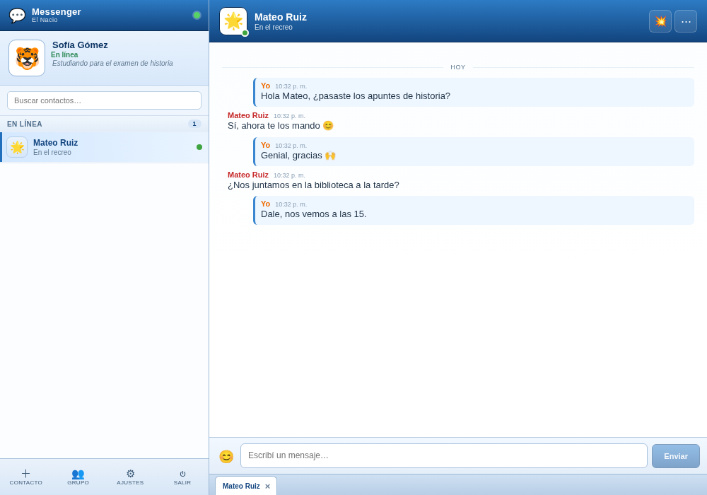

# Messenger El Nacio

[](https://github.com/marcoszinga94/messenger-el-nacio/actions/workflows/build-windows.yml)

Cliente de mensajería instantánea estilo MSN para una institución educativa. Servidor propio, clientes de escritorio para Windows y Linux, y panel de administración web.



## Descargar el cliente

El instalador de Windows se publica en [Releases](https://github.com/marcoszinga94/messenger-el-nacio/releases/latest).

1. Descargar `Messenger El Nacio_0.1.0_x64-setup.exe`.
2. Ejecutarlo. Si Windows muestra SmartScreen, elegir **Más información → Ejecutar de todas formas** (el instalador no tiene firma digital paga).
3. Abrir el cliente y registrarse con el código de invitación del curso, o iniciar sesión si ya tenés cuenta.

## Funciones

- Chat privado 1 a 1 en tiempo real.
- Salas de curso creadas por el administrador y grupos creados por alumnos.
- Lista de contactos con solicitudes, apodos y bloqueos.
- Estados: en línea, ausente, ocupado e invisible, con mensaje personal.
- Historial con retención configurable (30 días por defecto).
- Mensajes offline: se entregan al volver a conectarse.
- Zumbidos con límite antiabuso, emoticones clásicos y sonidos.
- Panel de administración: usuarios, invitaciones, salas, ajustes y auditoría.
- Registro con código de invitación.
- HTTPS automático con Caddy y despliegue en Windows.

## Stack

- **Servidor:** Node 24, Fastify 5, Socket.IO, SQLite (`node:sqlite`), JWT, scrypt.
- **Cliente:** Tauri 2 + React 19 + Vite + TypeScript, Zustand, Dexie (historial local).
- **Panel:** React + Vite servido por el mismo servidor en `/admin/`.
- **Compartido:** tipos, esquemas Zod, protocolo de socket y emoticones en `packages/shared`.

## Estructura

```
apps/
  server/      API REST + Socket.IO + panel estático + trabajos de retención
  admin/       SPA del panel de administración
  desktop/     Cliente Tauri + React
packages/
  shared/      Tipos, validaciones y protocolo compartido
deploy/        Scripts de ejemplo para Windows
docs/          Documentación de despliegue
```

## Desarrollo

Requisitos: Node 24+, pnpm 11+.

```bash
pnpm install
pnpm dev:server     # API en http://localhost:3000
pnpm dev:admin      # Panel en http://localhost:5174
pnpm dev:desktop    # Cliente en http://localhost:1420
```

La primera vez que arranca el servidor se crea un administrador. Si no definís `ADMIN_PASSWORD`, la contraseña se guarda en `data/ADMIN-CREDENTIALS.txt`.

Variables principales (ver `.env.example`):

| Variable | Descripción |
| --- | --- |
| `PORT` | Puerto local del servidor (3000 por defecto). |
| `DATA_DIR` | Carpeta de la base SQLite, secreto JWT y credenciales iniciales. |
| `ADMIN_USER` / `ADMIN_PASSWORD` | Administrador inicial (solo si la base está vacía). |
| `RETENTION_DAYS` | Retención inicial del historial. |
| `PUBLIC_URL` | URL pública del servidor. |
| `RELEASES_URL` | Página de descargas que se muestra en la portada. |
| `CORS_ORIGINS` | Orígenes extra permitidos, separados por coma. |

## Compilar el cliente

El workflow de GitHub Actions compila el instalador de Windows en cada tag `v*` y lo publica como release:

```bash
git tag v0.1.0
git push origin v0.1.0
```

Para compilar localmente hacen falta Rust y las dependencias de Tauri:

```bash
pnpm --filter @nacio/desktop tauri build --bundles nsis
```

El instalador queda en `apps/desktop/src-tauri/target/release/bundle/nsis/`.

## Servidor en producción

La guía completa está en [docs/DEPLOY-WINDOWS.md](docs/DEPLOY-WINDOWS.md). Resumen:

1. Instalar Node 24 en Windows.
2. Copiar `apps/server/dist/index.js` y `apps/admin/dist` al servidor.
3. Ejecutar el servidor como tarea programada o servicio, con `DATA_DIR` y `ADMIN_DIST`.
4. Poner Caddy delante para HTTPS y redirigir el puerto 443 en el router.
5. Programar backups de la base SQLite.

## Seguridad y privacidad

- Contraseñas con scrypt, tokens de acceso cortos y refresh rotativo.
- TLS obligatorio en producción; el puerto interno no se expone.
- Límite de 2.000 caracteres por mensaje y rate limiting en login, registro y sockets.
- Los logs no guardan el contenido de los mensajes.
- El historial se borra automáticamente según la retención configurada.
- Pensado para menores: se recomienda avisar a alumnos y familias y contar con autorización institucional.

## Estado

Versión 0.1.0. El cliente de Windows se compila con Tauri. El cliente de Linux (AppImage/deb) se agrega en la próxima etapa.

## Licencia

Proyecto educativo. Todos los derechos reservados por el autor hasta definir una licencia.
